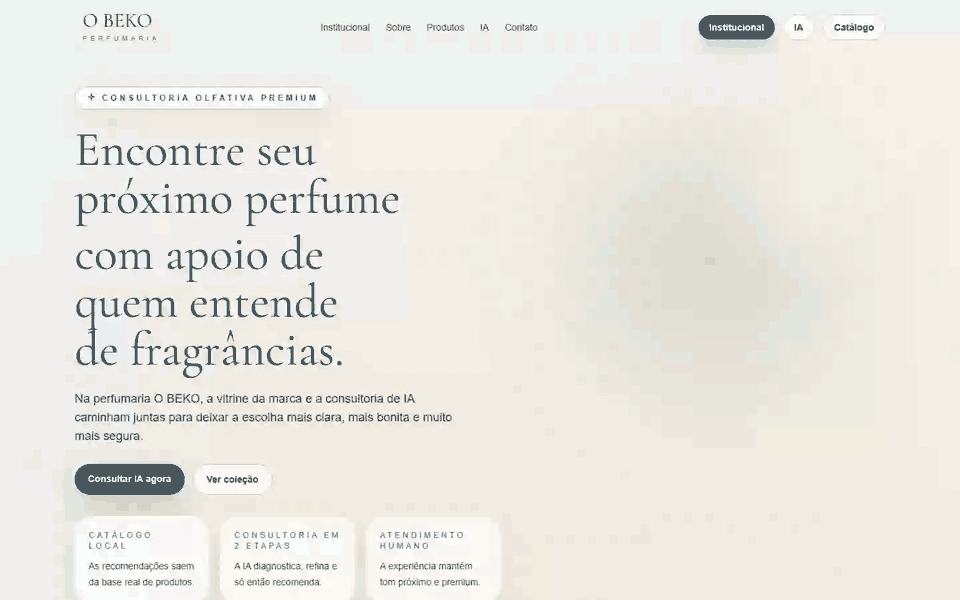
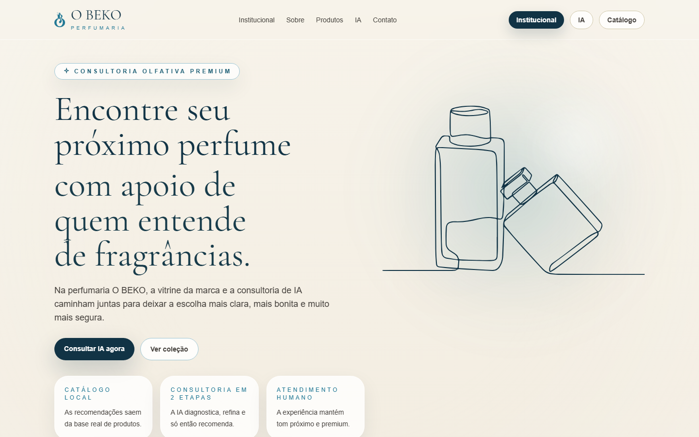
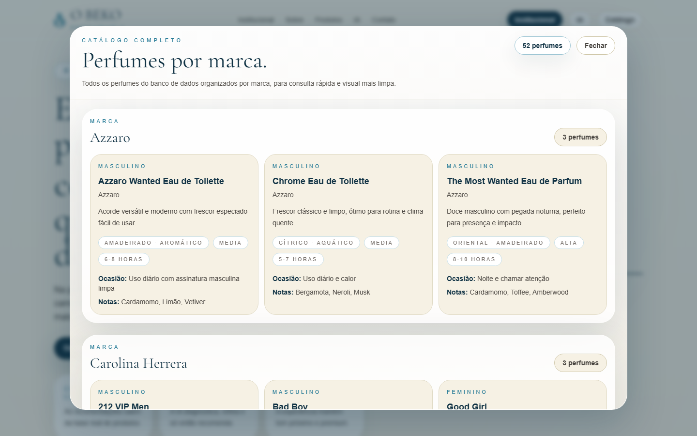
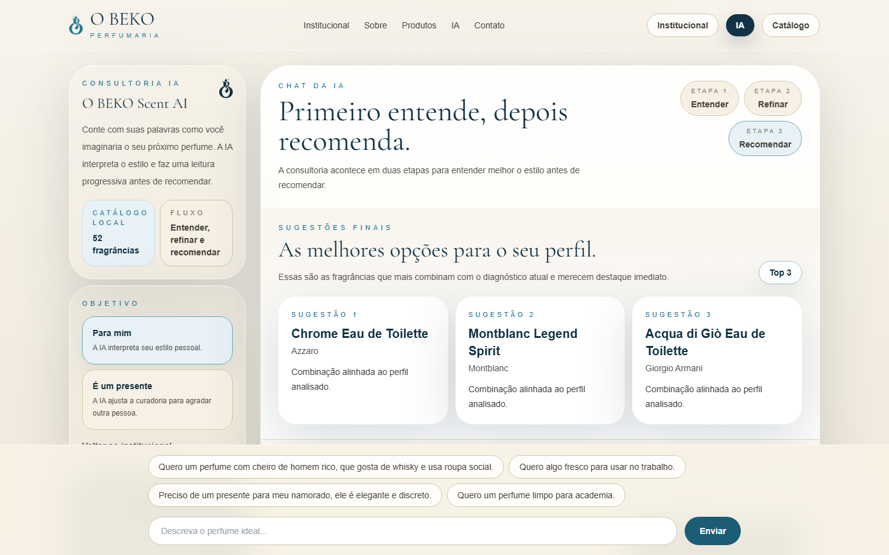
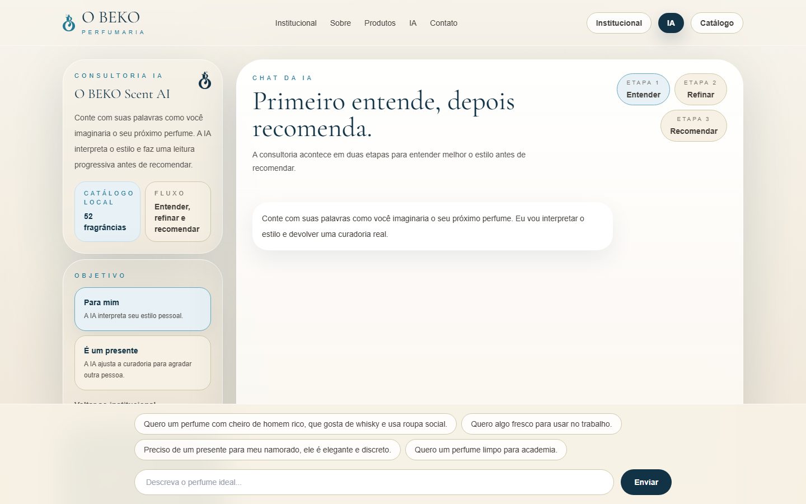
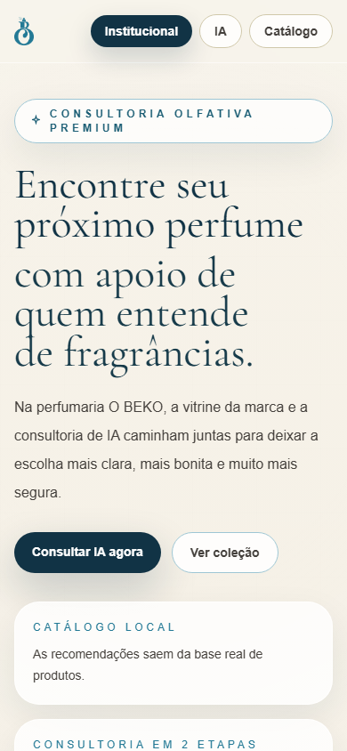
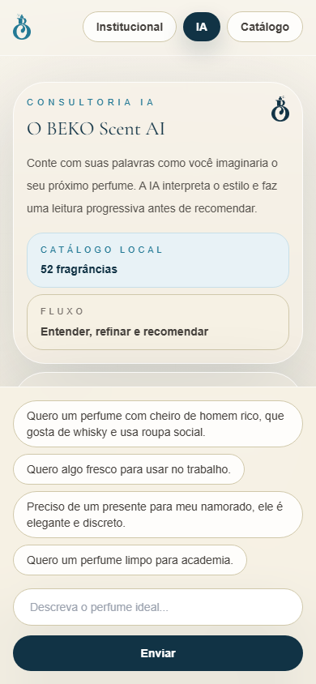

# O BEKO · Scent AI

**Uma experiência digital para descobrir fragrâncias com mais personalidade.**

Site institucional de perfumaria com catálogo por marca e uma consultoria conversacional que transforma descrições de estilo em sugestões de perfumes. A experiência aproxima a identidade da loja de uma escolha guiada: descrever, refinar e descobrir.

[Visão do projeto](docs/PROJECT.md) · [Arquitetura](docs/ARCHITECTURE.md) · [Executar e manter](docs/DEVELOPMENT.md) · [Validação](docs/VALIDATION.md) · [Mídias](docs/MEDIA.md)

> **Estado deste repositório:** versão estática compilada e funcional. Os fontes React, a configuração de build e os mapas de código não vieram no clone. A interface chama o recurso de “IA”; nesta versão, as recomendações usam regras e pontuação locais, sem modelo generativo ou serviço externo.

## A proposta

Escolher um perfume envolve preferências subjetivas: frescor, presença, ocasião, clima e a impressão que se quer transmitir. O projeto reúne apresentação da marca, consulta ao catálogo e orientação em uma única experiência, com caminhos para uso próprio e presente.

## Experiência

- **Institucional:** apresentação da perfumaria, categorias de produtos, dicas e canais de atendimento.
- **Catálogo:** 52 registros de 18 marcas, agrupados por marca, com notas, família olfativa, intensidade e ocasião.
- **Consultoria:** primeira mensagem gera um diagnóstico preliminar e perguntas; a resposta seguinte entrega um diagnóstico final e até três sugestões.
- **Personalização:** objetivos “Para mim” e “É um presente”, além de sugestões rápidas de mensagens.
- **Interface responsiva:** navegação por hash, cards, painel de diagnóstico e campo de mensagem fixo.

Os 52 registros correspondem a **49 combinações únicas de marca e nome**. Três perfumes têm entradas repetidas na base recebida; os números descrevem o catálogo, não métricas de uso.

## Veja funcionando



[Assistir à gravação completa em WebM](docs/media/demo-desktop.webm) · [Roteiro e condições de captura](docs/MEDIA.md)

| Página inicial | Catálogo por marca |
| --- | --- |
|  |  |



<details>
<summary>Consultoria inicial e telas móveis</summary>






</details>

As telas e a gravação mostram o app real, sem respostas simuladas. A captura foi feita em ambiente sem rede, com os arquivos originais servidos ao navegador por interceptação local e as fontes de fallback do CSS. A capa é uma peça editorial gerada para o portfólio, não uma captura da interface.

## Como a recomendação funciona

1. O texto é normalizado para comparação de palavras e expressões.
2. Regras identificam traços, famílias olfativas, ocasiões, clima e intensidade.
3. Cada perfume recebe pontos por correspondência com esses sinais.
4. A primeira interação pede refinamento; a seguinte apresenta os três primeiros do ranking.

O processamento acontece no navegador. Não há backend, chave de API, embeddings ou chamada a LLM no código recebido. O histórico aparece no chat, mas o cálculo atual considera principalmente a **última mensagem do usuário**. [Detalhes e limitações](docs/ARCHITECTURE.md).

## Identidade visual

Azul petróleo, areia e off-white sustentam uma direção editorial: títulos serifados, textos sem serifa, ilustrações lineares de frascos, superfícies translúcidas e cantos arredondados. O CSS declara **Cormorant Garamond** e **Manrope**, carregadas pelo Google Fonts quando há acesso à rede.

## Tecnologias e execução

| Camada | Implementação presente |
| --- | --- |
| Interface | React / React DOM 19.2.8 identificados no bundle |
| Estilos | CSS compilado com utilitários Tailwind |
| Recomendação | JavaScript, catálogo embutido e ranking por regras |
| Distribuição | HTML, JavaScript ES module e assets estáticos |
| Ferramentas adicionadas | Node.js 22+, servidor e verificações sem dependências |
| Capturas opcionais | Playwright |

Com **Node.js 22 ou superior**, na raiz do repositório:

```bash
node scripts/serve.mjs
```

Abra **http://127.0.0.1:4173**. Use `Ctrl+C` para encerrar. Se tiver npm disponível, `npm start` executa o mesmo servidor. Não é necessário instalar dependências para visualizar o site ou executar as verificações.

```bash
node scripts/check.mjs
```

Não existe etapa de build nesta entrega. Para hospedar, publique `index.html` e `assets/` juntos, preservando os nomes. Os caminhos relativos permitem uso em subdiretório, como no GitHub Pages. [Instruções de manutenção e publicação](docs/DEVELOPMENT.md).

## Organização

| Caminho | Responsabilidade |
| --- | --- |
| `index.html` | Entrada pública e metadados |
| `assets/` | Sete artefatos originais compilados, preservados |
| `docs/` | Produto, arquitetura, manutenção, validação e inventário |
| `docs/media/` | Capa, seis screenshots, GIF e gravação |
| `scripts/` | Servidor local, verificação e reprodução das capturas |
| `.github/` | Verificação automática e modelos de contribuição |

Os nomes com hash de `assets/` foram mantidos porque fazem parte das referências do bundle. O inventário registra os checksums para conferir sua integridade.

## Estado e próximos passos

O fluxo institucional → catálogo → diagnóstico → recomendações foi verificado em Chromium, com capturas desktop de 1440 × 900 e mobile de 390 × 844. Não foram observados erros JavaScript no roteiro executado. [Evidências e limites da validação](docs/VALIDATION.md).

- Recuperar os fontes de desenvolvimento para evolução sustentável.
- Revisar duplicidades e padronizar os campos do catálogo.
- Consolidar o contexto entre mensagens e melhorar filtros de preferência.
- Ajustar o espaço do compositor no celular e a acessibilidade do modal.
- Substituir contatos de exemplo e destinos genéricos das redes sociais.
- Caso seja desejada IA generativa, projetar uma integração de backend separada.

Não há checkout, estoque, autenticação ou persistência de conversas nesta versão. O motor local oferece uma demonstração de curadoria e não valida disponibilidade comercial dos perfumes.

## Autoria e contribuição

Projeto no perfil de [Rafael Poles · @rpoless](https://github.com/rpoless). Sugestões e manutenção: [CONTRIBUTING.md](CONTRIBUTING.md).

O clone original não contém uma licença de distribuição. Esta organização não adiciona uma licença ao código, à marca ou aos materiais visuais; a escolha de licenciamento fica com o titular do projeto.
