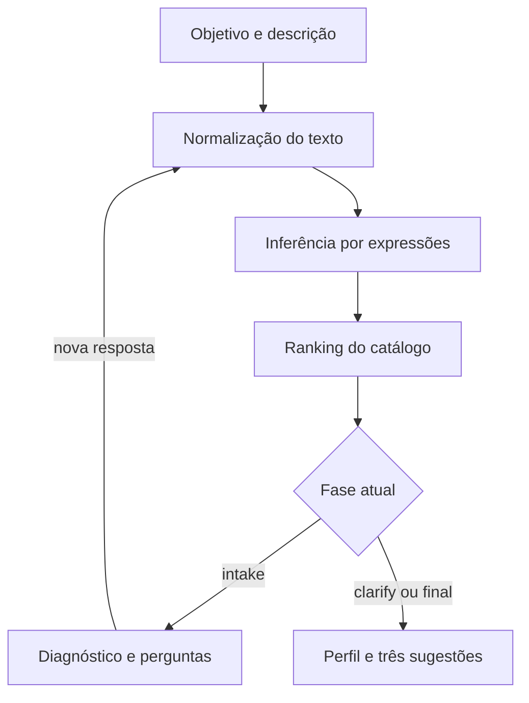

# Arquitetura observada

## Distribuição

`index.html` monta `#root` e carrega um ES module e um CSS em `assets/`. O JavaScript inclui React / React DOM 19.2.8, componentes compilados, catálogo e lógica de recomendação. Os nomes dos arquivos e o padrão de referências são compatíveis com saída de bundler, mas a configuração original não foi entregue.

O CSS contém utilitários Tailwind compilados e importação do Google Fonts. Não é possível afirmar a versão original do Tailwind ou reconstruir o build apenas com esses artefatos.

## Navegação e estado

Os principais modos são institucional e consultoria, alternados com `#institucional` e `#ia`. Seções institucionais usam âncoras, como `#sobre`, `#produtos` e `#contato`. Não há roteador de servidor. O catálogo abre como uma sobreposição com scroll próprio.

O estado React mantém página, objetivo, fase da consulta, perguntas pendentes, mensagens, entrada, resultado e estado do catálogo. Não há uso de armazenamento persistente no código de aplicação identificado; recarregar a página perde a conversa.

## Fluxo da consultoria

Há duas interações principais. A interface representa o processo com três indicadores: entender, refinar e recomendar.

## Regras e pontuação

O motor coloca texto em minúsculas e remove acentos. Grupos de expressões associam termos como “fresco”, “executivo” ou “intenso” a traços, famílias, ocasiões, climas e intensidades. Um dicionário adicional define pesos de palavras.

| Correspondência | Pontuação observada |
| --- | --- |
| Palavra do dicionário presente no pedido e nos dados do perfume | Duas vezes o peso configurado |
| Família inferida | +4 por correspondência |
| Traço de personalidade inferido | +4 por correspondência |
| Ocasião inferida | +3 por correspondência |
| Clima inferido | +2 por correspondência |
| Intensidade inferida | +2 por correspondência |
| Objetivo presente | Bônus para unissex (+4) e ocasião de presente (+3) |
| Objetivo para si | +1 para cada candidato |

O motor ordena em ordem decrescente e seleciona até três registros. Não há limiar mínimo de confiança ou diversidade explícita. Empates podem favorecer a ordem da base.

As funções de catálogo e consulta são assíncronas, mas devolvem dados locais. A única chamada `fetch` identificada no bundle está no suporte a `modulepreload`, não em uma integração de IA. Há também carregamento externo de fontes pelo CSS.

## Catálogo

São **52 registros**, **18 marcas** e **49 pares únicos de marca + nome**. Duplicidades de nome dentro da mesma marca:

- Chanel — Chance Eau Tendre.
- Dior — Miss Dior Eau de Parfum.
- Dior — J'adore Eau de Parfum.

Os registros incluem marca, gênero, famílias, pirâmide de notas, intensidade, fixação, ocasiões, clima, personalidade, palavras-chave e descrição. Os valores de fixação e descrições são conteúdo da base recebida, sem validação técnica nesta entrega.

## Limitações conhecidas

1. **Contexto parcial:** o ranking utiliza a última mensagem do usuário e o objetivo; mensagens anteriores e perguntas pendentes não são consolidadas semanticamente.
2. **Preferências sem filtro rígido:** gênero, orçamento e indisponibilidade não são tratados como filtros de catálogo. Não há preços nem estoque.
3. **Objetivo durante uma consulta:** trocar de objetivo no painel não limpa automaticamente as mensagens e o diagnóstico. Um botão de reinício explícito seria uma evolução útil.
4. **Descrição da recomendação:** o motor retorna `reason`, mas o card lê `descricao` ou `observacao`; por isso a tela usa uma descrição genérica. As capturas preservam esse comportamento.
5. **Modal:** não foram identificados `role="dialog"`, gestão explícita de foco ou fechamento por Escape na implementação recebida.
6. **Mobile:** o compositor fixo com quatro sugestões ocupa uma parcela grande da altura disponível.
7. **Conteúdo demonstrativo:** telefone com repetição de dígitos, destinos genéricos de redes sociais e endereço sem logradouro precisam de revisão.
8. **Fontes externas:** sem Google Fonts, o navegador usa as alternativas declaradas no CSS.

Essas observações são de leitura do bundle e do roteiro de navegação; não representam uma auditoria de acessibilidade, segurança ou qualidade dos dados. Os artefatos originais foram preservados. [Como evoluir](DEVELOPMENT.md).
